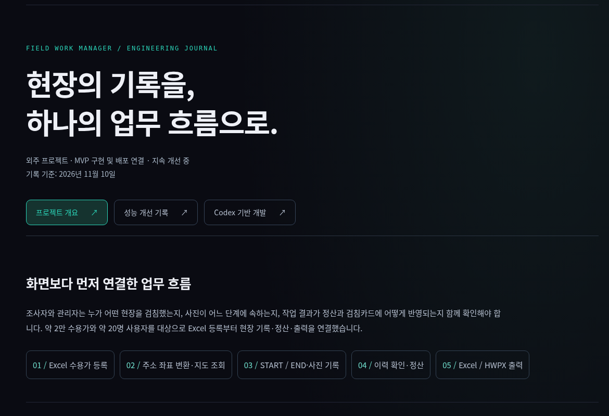
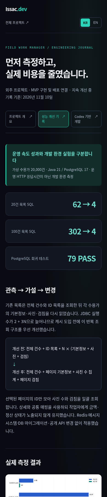

# 수도관리자 상세 페이지 최신화 — 2026-11-10

현재 상태: 별도 브랜치 구현·로컬 빌드/브라우저 검증 완료. main 병합과 GitHub Pages 배포는 별도다.

## 변경

홈의 수도관리자 상태를 설계 중에서 MVP 구현·운영 연결·성능 개선 단계로 갱신했다. 기존 카드에서 다음 세 페이지로 이동하며 한국어/영문 모두 제공한다.

- `#/projects/field-work`: 현장 업무 흐름, 구성도, 등록/검침/권한/정산/문서 정책
- `#/projects/field-work/performance`: 목록 SQL 일괄 조회의 전후 수치, 그래프, 환경, 해석의 제한, PDF·원시 JSON
- `#/projects/field-work/codex`: 사용자의 업무 판단·최종 검토와 Codex의 구현/테스트/계측 지원을 구분한 개발 과정

실제 개선과 근거는 [field-worker PR #34](https://github.com/issac-52/field-worker/pull/34)에서 확인한다. 프로젝트 원본의 `docs/performance/2026-11-10-list-optimization/` 자료를 복사했다. `src/pages/fieldwork/model/performance.json`과 원시 JSON의 수치 일치를 확인했다.

기존 야장관리자와 경력·실무 사례는 유지했다. 야장관리자의 Claude Code 설명을 수도관리자의 Codex 활용과 혼합하지 않는다. 경력 기간이나 확인하지 않은 운영 성과는 추가하지 않았다.

## 결과를 표현한 기준

- 목록20건 SQL62→4,100건302→4. 첫 페이지p50은21.68→5.53ms,74.75→8.56ms다.
- PostgreSQL 회귀79개 통과. 검색 p50의 작은 변화와 남은 전체 스캔 비용도 표시한다.
- 가상2만 건·동일환경·조회별10~20회 표본의 전후1쌍이다. 서비스/컨트롤러+JSON 측정이며 운영 HTTP/Cloudflare/실제R2/브라우저 성능을 의미하지 않는다.
- 문서 캐시 재사용과 코드 개선 전후를 구분한다. 이번 개선에서 지도/문서/Redis/SQS 변경은 하지 않았다고 표시한다.
- 고객 Excel·사진·좌표·계정·자격 증명은 포함하지 않는다.

## 실제 검증

```bash
npm ci --no-audit --no-fund
npm run build
npm run preview -- --host 127.0.0.1 --port 5185 --strictPort
```

Chromium 로컬 브라우저로 390/1440px × 한국어/영문 × 상세3페이지(12조합)를 확인했다. 각 페이지의 직접 접근·활성 메뉴·제목 표시·가로 넘침 없음, 그래프 로딩, PDF 응답 및 서명, 원시 JSON의 실제 수치를 검사했다.

추가로 각 크기에서 홈 카드→상세→성능→EN→새로고침→키보드 본문 이동→홈 복귀를 확인했다. 언어 유지·페이지 제목/문서 lang·키보드 초점·콘솔 예외 없음도 확인했다. 시각 검토에서 제목의 어두운 색을 보정한 뒤 동일 검증을 통과했다.

소스 변경과 공개 자료를 PR로 제공하며 직접 main 병합이나 배포를 수행하지 않았다. main 병합 후 기존 GitHub Actions의 Pages 배포로 반영된다.

## 화면




